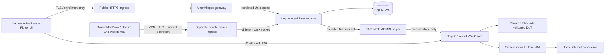

# Architecture

`duct-core` contains protocol types, vetted cryptography, strict state/protection models, migrations and transactional registry operations. SQLite is an optional feature, excluded from native client-only builds. `duct-server` supplies the two-socket registry daemon, restricted HTTP gateway, bounded privileged helper, trusted-local CLI and TUF staging tool. `duct-bridge` exposes JSON crypto/enrollment functions to native code through a bounded C interface and Android JNI. Secret-bearing bridge messages stay inside native infrastructure; Flutter receives public fingerprints and status only.

The gateway has no database access, private key, admin socket or privileged socket. Its public routes are exactly challenge, claim and authenticated polling. TLS termination must run as a separate, appropriately constrained identity. Do not put the public ingress identity in the private admin socket group. The registry creates the admin socket inside a separately group-owned setgid directory. Public and private sockets have mode 0660; runtime directories are 0750.

The privileged helper accepts only a revision and at most 250 validated public-key/address-slot pairs. It generates narrow /32 and /128 AllowedIPs itself. It reads `/usr/bin/wg show dtvpn0 peers` with a two-second timeout, then invokes `/usr/bin/wg set dtvpn0` with validated peer updates and explicit removals, no shell and a four-second timeout. An empty desired set removes all existing peers. Updates preserve the interface private key, listening port and routing mark, plus retained peers' endpoint, keepalive and preshared key. Peer-only `syncconf` must not be used: omitted interface fields clear the private key and routing mark and randomize the listening port. Paths, interfaces, arbitrary IP ranges, commands, keys for the server itself and firewall mutations are not part of the helper API. The helper is not a general root agent. Host interface/firewall creation is a separate reviewed oneshot deployment action.

SQLite uses foreign keys, FULL synchronous WAL, an explicit schema version and immediate transactions. Invitation consumption and creation of the pending device are atomic. Signing/WireGuard keys and address slots are unique. The sole Owner row is a macOS record created only by trusted-local bootstrap/recovery. Public enrollment always creates an ordinary Client. An outbox-like desired revision plus applied revision drives full-state reconciliation every two seconds. Configuration polling does not return ready until the helper has acknowledged that revision. Revocation is persisted before reconciliation; signed admin responses expose both revisions, so acknowledgement of a registry change must not be confused with confirmed data-plane removal.

Gateway, pairing and administration failures do not tear down the WireGuard interface. The owned network service has no dependency on the public gateway or registry. Existing tunnels continue while those components are unavailable. A failed helper delays new provisioning and revocation enforcement; the Owner must inspect the revision lag. Tunnels cannot be simultaneously preserved through all management failures and guaranteed to enforce a new revocation while the privileged helper is unavailable.

The Flutter presentation has no authority to declare traffic protected. Desired state, actual tunnel state, protection, permission and fresh verification are independent fields. Apple uses NETunnelProviderManager and a separate WireGuardKit packet-tunnel extension. Android uses the official GoBackend plus a foreground supervisor, persisted ON preference, boot receiver and bounded retries. Windows uses an independently installed SCM agent, the official tunnel service entry point, Credential Manager and application-owned persistent WFP filters. UI destruction has no intentional disconnect path. Native status is deliberately conservative until real traffic verification and platform enforcement have been certified.
